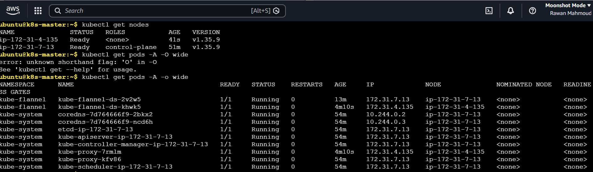
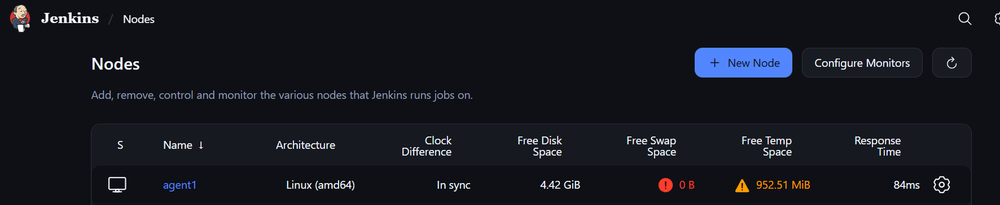
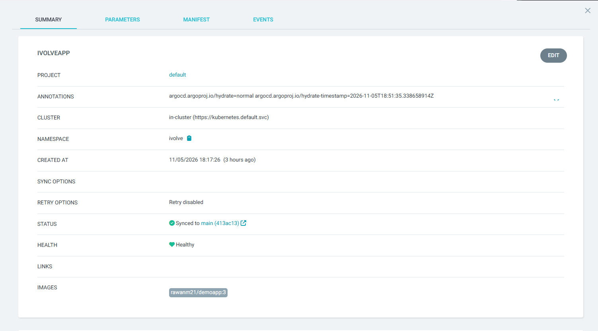

# Lab Evidence and Project Status

These screenshots came from earlier labs. They show individual milestones, not a completed deployment of this new repository.

## kubeadm cluster

The original Kubernetes lab captured nodes and pods after cluster setup.

## Jenkins agent

The Jenkins lab captured a connected Linux agent named `agent1`.

## Argo CD GitOps

The Argo CD lab captured a `Synced`, `Healthy` Application for `rawanm21/demoapp:3`. That image is the separate Java demoapp, not this repository's Node.js app.

## Live read-only inspection

On 12 November 2026, the provided EC2 control-plane host reported three Ready Kubernetes nodes, an existing `ivolveapp` Argo CD Application that tracks `https://github.com/rawanmahmoud659-hub/demoapp`, and existing `demoapp` and `ivolveapp` Deployments in namespace `ivolve`. The local repository created here was not pushed or applied to that cluster.
